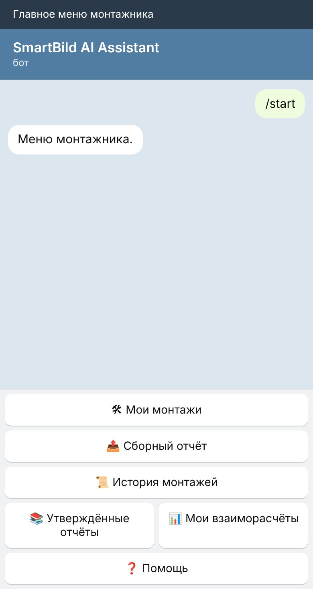
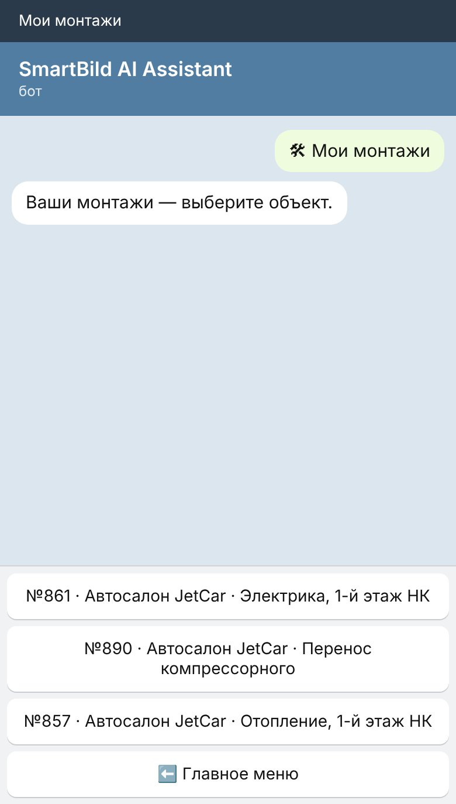
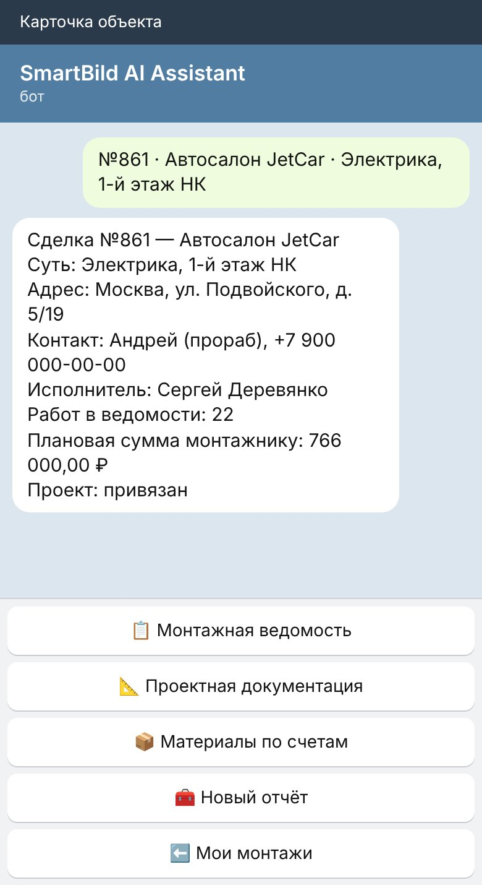
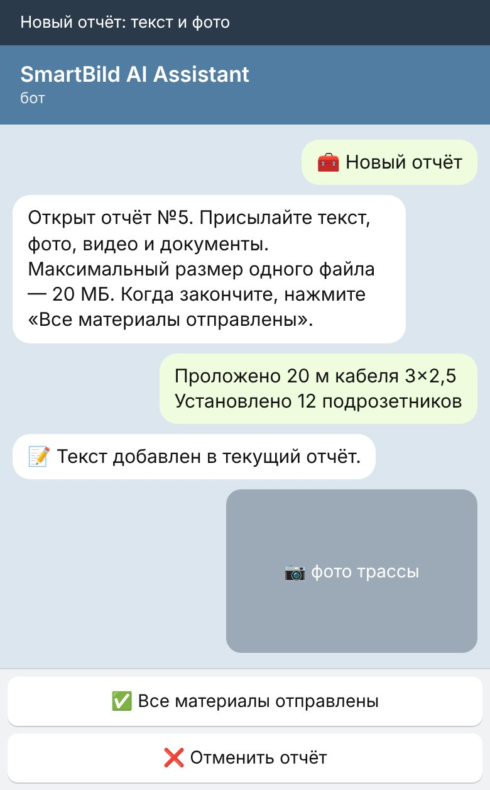
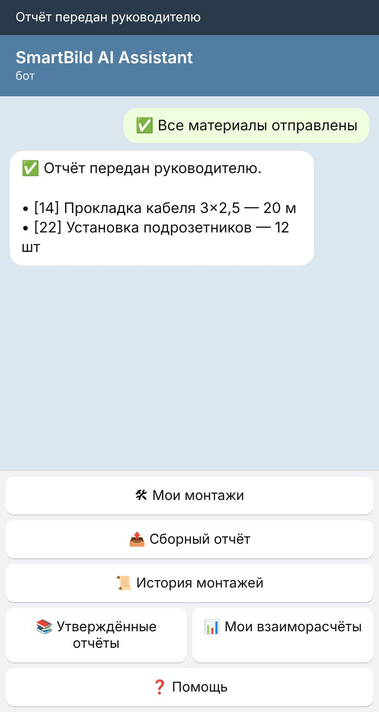
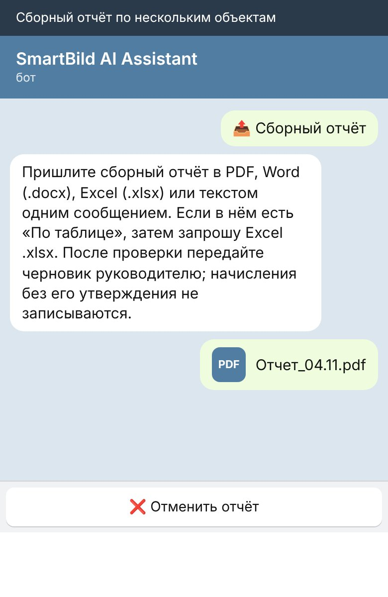
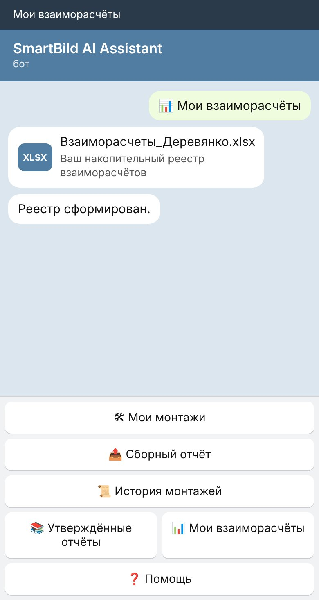
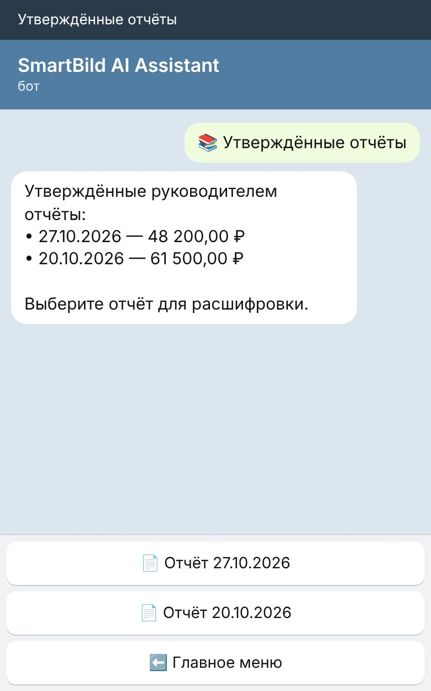
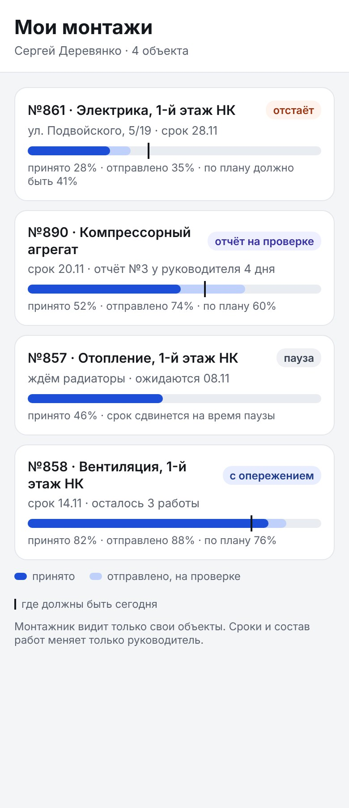
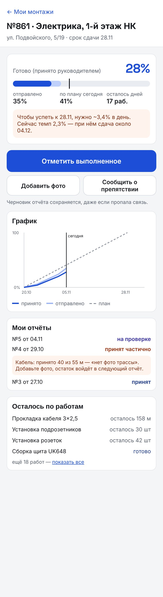

# Инструкция монтажника: кабинет в боте SmartBild и пульт монтажа

Эта инструкция всегда под рукой: в меню бота нажмите «📘 Инструкция» и выберите раздел.
Каждый раздел — короткий, с картинкой экрана. Ничего страшного не случится, если нажать
не ту кнопку: бот ничего не записывает без вашего «Все материалы отправлены» и без проверки
руководителя.

## 1. Как устроен кабинет

Кабинет — это наш бот SmartBild AI Assistant в Telegram. Всё делается кнопками.

- **Кнопки внизу экрана** — это меню. Если они пропали, нажмите значок клавиатуры справа
  от поля ввода или напишите /start.
- **Кнопки под сообщением** относятся к этому сообщению. После нажатия они гаснут — так бот
  защищает от двойного нажатия. Если кнопки погасли, откройте раздел заново из меню.
- **«⬅️ Главное меню»** всегда возвращает в начало. Черновик открытого отчёта при этом
  сохраняется.

Главное меню:
- 🛠 Мои монтажи — ваши объекты и отчёт по одному объекту;
- 📤 Сборный отчёт — один отчёт (PDF, Word, Excel или текст) сразу по нескольким объектам;
- 📜 История монтажей — завершённые объекты, только посмотреть;
- 📚 Утверждённые отчёты — что руководитель уже принял;
- 📊 Мои взаиморасчёты — начисления, выплаты и долг;
- ❓ Помощь — краткая памятка; 📘 Инструкция — эта инструкция.

## 2. Мои монтажи: объект и его документы

1. Нажмите «🛠 Мои монтажи» — бот покажет переданные вам объекты.
2. Выберите объект кнопкой.

В карточке объекта: клиент, суть работ, адрес, контакт на объекте, число работ в ведомости,
плановая сумма вам и есть ли проект.

Кнопки объекта:
- 📋 Монтажная ведомость — Excel: какие работы, сколько и по какой расценке;
- 📐 Проектная документация — файлы проекта, если он есть;
- 📦 Материалы по счетам — что закуплено по объекту: PDF для телефона и Excel, без цен.
  Это не подтверждение доставки: если чего-то нет на объекте — спросите руководителя;
- 🧰 Новый отчёт — сообщить, что сделано (следующий раздел).

Если объекта нет в списке — его ещё не передали вам в монтаж. Напишите руководителю.

## 3. Отчёт по одному объекту

1. «🛠 Мои монтажи» → объект → «🧰 Новый отчёт».
2. Напишите, что сделано **за этот период**: название работы, количество, единица.
   Каждая работа — с новой строки.
3. Пришлите фото, видео или документы (каждый файл до 20 МБ). Фото трассы, щита, узлов —
   лучшее доказательство: без фото руководитель может принять работу частично.
4. Нажмите «✅ Все материалы отправлены». Бот покажет, как он понял ваши строки, и передаст
   отчёт руководителю.

**Хорошо:**
«Проложено 20 м кабеля 3×2,5»
«Установлено 12 подрозетников»
«Собран щит UK648 — 1 шт»

**Плохо:**
«Сделал почти всё по кабелю» — нет количества;
«Всего проложено 180 м» — это итог за всё время, а нужно только новое за период;
«Кабель, розетки, щит» — непонятно, сколько.

Передумали — «❌ Отменить отчёт»: черновик закроется, к оплате ничего не уйдёт.

## 4. Сборный отчёт по нескольким объектам

Удобно, если за неделю работали на нескольких объектах и у вас один общий документ.

1. Главное меню → «📤 Сборный отчёт».
2. Пришлите отчёт файлом PDF, Word или Excel — или текстом одним сообщением.
3. Если в отчёте есть строки «По таблице», бот попросит Excel-таблицы: пришлите их и нажмите
   «✅ Все файлы загружены».
4. Проверьте, к каким объектам бот отнёс строки, исправьте ошибки, ответьте на вопросы бота.
5. Нажмите «📤 Передать руководителю».

Начисления не записываются, пока руководитель не утвердит отчёт.

## 5. Что происходит после отправки

Отправить отчёт — не значит получить приёмку или оплату. Дальше решает руководитель:
- **Принят** — работы засчитаны, обновятся ведомость, прогресс и начисления.
- **Принят частично** — часть объёма засчитана. Причина указана в отчёте, например «нет фото
  трассы». Исправьте причину, остаток впишите в следующий отчёт.
- **Возвращён** — прочитайте причину, исправьте и отправьте новый отчёт.

Нельзя: отправлять уже принятый отчёт повторно ради исправления. Если в принятом ошибка —
напишите руководителю. Повтор не удвоит объём: бот не даст принять больше, чем в ведомости.

## 6. Материалы, доставка и другие расходы

Расходы, которые не являются работой по ведомости (материалы, доставка, такелаж, парковка),
пишите отдельной строкой: объект, на что, сумма. Например:
«№861 — доставка кабеля — 1 500 ₽».
Не распределяйте такие расходы на работы сами и не добавляйте их к расценкам — руководитель
решит, куда их отнести.

## 7. Мои взаиморасчёты

«📊 Мои взаиморасчёты» присылает Excel: ваши отчёты, начисления по принятым работам, выплаты и
итоговый долг. Выплаты вносит руководитель.

Важно: по новым безналичным выплатам засчитывается 94% суммы, по наличным — 100%. Старые
выплаты не пересчитываются.

## 8. Утверждённые отчёты и история монтажей

- «📚 Утверждённые отчёты» — список принятых отчётов с суммами; кнопка отчёта откроет его
  расшифровку по объектам.
- «📜 История монтажей» — завершённые объекты: можно открыть ведомость, но новый отчёт по
  ним создать нельзя.

## 9. Прогресс монтажа и мой пульт

Скоро в «🛠 Мои монтажи» появится кнопка «📊 Мой прогресс» — она открывает ваш пульт монтажа
прямо в Telegram. Там только ваши объекты.

Как читать полосу:
- **тёмная часть** — работы, принятые руководителем (это и есть официальная готовность);
- **светлая часть** — отправлено вами, ещё на проверке;
- **чёрная черта** — где по графику нужно быть сегодня.

Если тёмная часть левее черты — объект отстаёт. На экране объекта видно, сколько нужно делать
в день, чтобы успеть к сроку, ваш график, статусы отчётов с причинами частичной приёмки и сколько
осталось по каждой работе. Сроки и состав работ меняет только руководитель.

В пульте нет цен материалов и экономики сделки — только ваша работа: проценты, объёмы и сроки.

## 10. Если что-то мешает работать

Нет материалов, нет доступа на объект, нет электричества, ждёте решения клиента — нажмите
«🚧 Сообщить о препятствии» на объекте (появится вместе с пультом) или напишите руководителю.
Руководитель поставит объект на паузу: пока пауза, срок не «горит» и отставание вам не
засчитывается.

## 11. Частые вопросы

- **Бот ответил «Сначала откройте объект в Моих монтажах…»** — вы прислали фото не в отчёт.
  Откройте объект → «🧰 Новый отчёт» и пришлите фото снова.
- **Кнопки не нажимаются** — они устарели. Откройте нужный раздел из меню заново.
- **Объекта нет в «Моих монтажах»** — его ещё не передали вам. Напишите руководителю.
- **Бот сообщил об ошибке** — не нажимайте одно и то же много раз. Сохраните сообщение
  (скриншот) и перешлите руководителю.
- **Ошибся в отправленном отчёте** — не отправляйте его заново, напишите руководителю.

## 12. Шпаргалка

Отчёт по объекту: 🛠 Мои монтажи → объект → 🧰 Новый отчёт → текст «работа — количество —
единица» → фото → ✅ Все материалы отправлены.
Несколько объектов: 📤 Сборный отчёт → файл → проверить → 📤 Передать руководителю.
Деньги: 📊 Мои взаиморасчёты. Что принято: 📚 Утверждённые отчёты.
Прогресс: 🛠 Мои монтажи → 📊 Мой прогресс.
Не знаете, что делать: ❓ Помощь, 📘 Инструкция или напишите руководителю.
